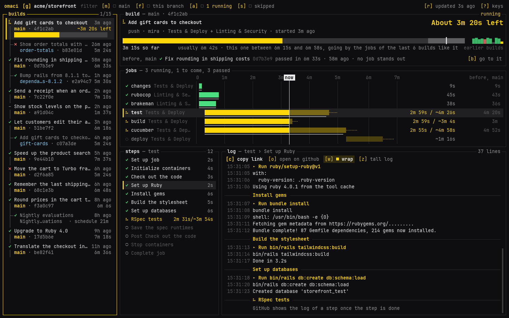
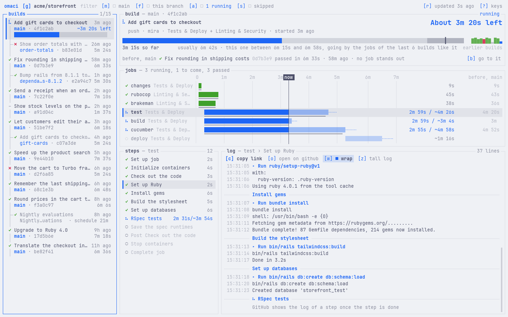

# Omaci


Live builds for a repository or a GitHub organization. See how far a build has come, how long it usually takes, and the jobs, steps and logs of the build you pick.

A bar widget can tell you that a build is red. It cannot tell you why, and finding out means a browser tab, three clicks into GitHub's Actions page, and a log viewer that loads a few thousand lines into a web page and scrolls them like one. This is the other half: open the build and the failing job is already selected, with the log on the test that failed rather than on the exit code that came after it, and one key copies the link to hand to somebody else.

It is a native Qt Quick app that looks like a terminal program, because that is what sits well on an Omarchy desktop: the desktop's monospace font at one size, panels as thin frames with their title in the top edge, bars made of blocks, and every action written as `[c] copy link`, which you can press or click. New lines slide into the log and the view glides along with them, the running marks spin, and the colours follow your Omarchy theme as you switch it, the light ones too.

## Install

```bash
git clone https://github.com/jankeesvw/omaci.git
cd omaci
bin/install
```

That builds the app and installs it as an Arch package with `makepkg -fsi`, so it shows up in the app launcher as Omaci, with its own icon. It asks for your password once, for the `pacman -U` at the end.

## Requirements

Omarchy, which already ships everything the build needs: Qt 6, `qmake6` and a compiler. And the [`gh` CLI](https://cli.github.com), logged in with `gh auth login`. Every request goes through it, so Omaci never sees or stores a token, and private repositories work exactly as far as your `gh` login can see them. A `gh` installed through mise is found too, also when the launcher starts the app without your shell's `PATH`.

## Which repository or organization

```bash
omaci                                  # the repository of the directory you are in
omaci basecamp/omarchy                 # any other
omaci basecamp/omarchy --sha 4f1c2ab   # open on the build of one commit
omaci org:basecamp                     # watch a GitHub organization
```


Started without a target, Omaci opens the current checkout or the last repository or organization you watched. On the first launch outside a checkout, it opens the picker. Press `G` to reopen it. Type to narrow the list (`acme api` finds `acme/storefront-api`) and use the arrows and Enter to pick. You can type a full `owner/name` directly or enter `org:name` to watch an organization.

The organization view combines the 30 latest workflow runs per accessible, non-archived, enabled repository. Each build shows its repository. Press `U` or click **PR author** and enter a GitHub username. Omaci looks up that user's 100 most recently updated pull requests in the organization and checks the latest 100 workflow runs in each repository found. Builds are matched by PR number or current PR head commit and appear as repositories are checked. Older runs can be absent from the filtered view when GitHub provides no matching PR reference. Submit an empty field or click **Clear filter** to see all builds again. Omaci remembers the filter for each organization.

There is only ever one window. Starting Omaci again hands the target and any commit to the open window and brings it to the front.

With `--sha` the build of that commit is the one selected, and the others stay in the list around it, because they are what the estimate is made from. A commit too old to be among the latest builds is looked up by its sha, which has to be the whole one for that.

It was called CI Watch before, and `ciwatch` still starts it.

## With GitHub Build Monitor

The [GitHub Build Monitor](https://github.com/jankeesvw/omarchy-github-build-monitor) bar widget opens a build here when you press Enter on it, as long as Omaci is installed. `g` in the widget still opens the build on GitHub.

## What counts as a build

A commit, not a workflow run, the same as in the widget. One push starts several workflows and they finish minutes apart, so every run that a push, a pull request or a dispatch started for a commit is rolled into one row: running while any of them is, red when any of them failed, and as long as the wait from the first run starting to the last one ending. Their jobs are one list.

Runs started by something else, a schedule or a comment on an issue, attach to the head of the branch as well. Counting those in would stretch a four minute build to half a day because a nightly job ran on the same commit, so each of them is an entry of its own.

Builds in which everything was skipped are hidden, because a repository with an issue bot has more of those than builds. `S` shows them. The bar at the top has the filters, each with a box that is filled while it is on: `M` keeps only the builds of main (or whatever the default branch is called), `F` only the branch of the build you are on, `A` only the builds that are running or waiting for a runner, and `S` shows the skipped ones too. Click a filter or press its key to flip it. With `A` on, the build you are looking at stays in the list when it finishes, so it doesn't disappear at the moment it has news; the next one you pick replaces it.

## How long it will still take



The largest text in the window is the answer: "About 3m 20s left". Under it is one bar. The filled part is the time gone, the tick is where a build like this usually ends, and the band around the tick is how far apart the earlier ones ended, so you see what the estimate is worth along with the estimate. Next to it are those earlier builds as a sparkline, one character each, as tall as the build was long and coloured by how it ended. Point at one for its name and its time, click it to go there.

The estimate comes from builds that passed, on the same branch when there are at least three of those, otherwise from builds started the same way, so a pull request is compared with other pull requests, which do not deploy. From the last six of them the app takes the jobs: how long each one usually runs, and which jobs had always finished before it began. Then it plays this build forward. A running job ends at its start plus its usual length, a job that has not started begins when the ones it waits for are done, and the build ends when the last job does. That is how the timeline can show a `deploy` that GitHub has not created yet, drawn shaded where it will be.

It is done three times, with every job quick, usual and slow, and the quick and slow answers are the band on the bar. The number is rounded to what it can be trusted to and always says "about". With fewer than three earlier builds there is no guess: the bar becomes a moving stripe and the text says how long the build has been going. A build that has outlasted its estimate says "Taking longer than usual", in yellow, with how far over it is, rather than sitting at zero.

A finished build keeps the bar, now showing whether it was faster or slower than usual.

## Next to the build before it


Under the bar is the build main had before this one: what it was, how it ended, how long it took, and in a few words what is different now, the worst first: "test broke, build 1m 9s slower". Click that row or press `B` to go to it; `Shift+B` brings you back to where you were.

On the timeline every job has a thin line under its bar where the same job ran in that build, so slower and later show without reading a number, and the column on the right has the time it took then. An arrow up in yellow is slower now, an arrow down in green is faster, and a job that fails now but passed then says so in red. Differences under five seconds or fifteen percent get no colour, because runners are never exactly as fast twice.

It is main also when you look at a pull request, because main is what the pull request gets merged into, and it is the previous build whatever its result: a main that was already red is worth knowing before blaming your branch.

## The jobs, in time

Every job is a row on the same time axis. Solid blocks are what happened, shaded ones are what is still expected, the dashes after them are how much longer it takes when the job is slow, and the vertical line is now. One look says which job the build is waiting for. On the right is how long the job has run and how long it usually does. Jobs that were skipped share one line at the bottom.

Pick a build and the job worth looking at is already selected: the one that failed, otherwise the one that is running, otherwise the last one that did any work. While a build is going, the selection moves along to whichever job is running now, until you pick one yourself.

| | |
|---|---|
| `⠹` spinning | running |
| `○` | queued |
| `◌` | expected, going by earlier builds, but not created yet |
| `✓` green | passed |
| `✗` red | failed, timed out, or never started |
| `–` | cancelled, which is what GitHub does to a run a newer push replaced |
| `⊘` | skipped |

## When a build fails


The runner's own error line, "Process completed with exit code 1.", is the last line of a failed step and says nothing. What the test runner printed says everything, and with tests running in parallel it can sit a hundred lines higher, behind the summaries of the processes that passed. Omaci reads the failed step for what test runners print: RSpec's `Failures:` section and its `rspec ./spec/…` lines, Cucumber's `Failing Scenarios:`, Minitest's `Failure:` blocks, pytest's `FAILED`, Jest's `●`, Go's `--- FAIL:`, and error annotations that name a file. The exit code line is only where it lands when none of those are there.

A failed job opens with the first failure at the top of the log, and a panel above the log names each one with its file and line. Click one to go there. `E` and `Shift+E` walk through them. The lines of a failure have a red edge, so they are easy to find again while scrolling.

The list is drawn the way `git log --graph` draws history: the builds of the default branch sit on a line down the left, with the branch name in the accent colour, and the builds of every other branch (pull requests, Dependabot, a scheduled run) hang off that line, set in, with a dimmer title and their branch name in a colour of its own. The heading of a build that is not on main says so.

Every step is a way into the log. Click one, or press `N` and `P`, and the log shows where that step ends, at the bottom of the view, because that is where its outcome is: the summary of a test run, or the error a command stopped on. A step that is still running is followed as it writes. The log has a heading at each of those places, and while you scroll, the step you are reading is the one marked in the list. Steps that were skipped wrote nothing and cannot be clicked.

## Handing it to somebody else

`C`, or the Copy link button, copies the address of the job you are on, `https://github.com/owner/repo/actions/runs/…/job/…`, or the run's when the build has no jobs yet. That is the thing to paste to a coding agent.

`Y` copies the failure itself: a line saying which job and step failed, in which repository and on which commit, the link, and the text of the failure as the test runner printed it. `Shift+C` copies the whole log. `O` opens the job on GitHub, on the step you picked if you picked one.

## Following a running build

In a repository, Omaci polls GitHub every 6 seconds while a build is running and once a minute when idle. With a PR author filter, the organization refreshes once a minute. In the organization-wide view, Omaci rechecks repositories with active builds after 15 seconds, recently active repositories after a minute, and quiet repositories after 10 minutes. Pushes and workflow activity in the past 24 hours count as recent. The repository list is reused for five minutes, and workflow requests are sent in batches. Press `Space`, `R` or `Ctrl+R` to refresh all repositories in the view. Omaci fetches the running job's log on each poll and appends new lines to keep your place.

It follows the end as long as you are at the end. Scroll up to read something and it stops, and a button in the corner brings it back, as does `End`. Scroll back down to the bottom and it follows again.

GitHub only publishes a job's log once the runner has uploaded the first part of it, so a job that just started shows its steps for a few seconds before it has a log.

When a build you saw running finishes, you get a desktop notification saying whether it passed and how long it took. Builds that were already done when the window opened stay quiet. The time left is in the window's title as well, so the window switcher shows it.

`Z` gives the whole height to the log, and `Z` or `Esc` brings the build back.

## Keyboard

Every one of these is also something you can click.

| Key | Does |
| --- | --- |
| `J` / `↓` | next build |
| `K` / `↑` | previous build |
| `L` / `→` / `Tab` | next job |
| `H` / `←` / `Shift+Tab` | previous job |
| `N` / `P` | next, previous step in the log |
| `E` / `Shift+E` | next, previous failure |
| `C` | copy the link of the job |
| `Y` | copy the failure and its link |
| `Shift+C` | copy the whole log |
| `O` / `Enter` | open the job on GitHub |
| `B` / `Shift+B` | the build main had before this one, and back |
| `Z` | tall log, and back |
| `W` | wrap long log lines, and back (on at the start) |
| `M` | only the builds of main, and back |
| `F` | only the branch of this build, and back |
| `A` | only the builds that are running, and back |
| `S` | show or hide skipped builds |
| `PgUp` / `PgDn` | scroll the log |
| `Home` / `End` | top of the log / back to following the end |
| `Space` / `R` / `Ctrl+R` | refresh now |
| `G` | watch a repository or organization |
| `U` | filter an organization by pull request author |
| `Esc` | close the help, or leave the tall log |
| `?` | every shortcut, in the window |
| `Q` | quit |

## What it costs

GitHub allows 5000 requests an hour per user, shared with everything else that uses your `gh` login.

Polling needs one request per repository for workflow runs. The organization view lists repositories or looks up recent pull requests when the author filter is active. Workflow run and job requests are sent with the previous response's `ETag`, so an unchanged response typically costs nothing. The running job's log always counts as a request. A finished run's jobs are kept in memory.

The menu of repositories is one request per hundred repositories, when you open it, and again at most every five minutes.

The comparison needs the jobs of the previous build on main, a request or two, once per build you look at. The estimate needs the jobs of the last six builds like yours, about a dozen requests, once, and only when the build you are looking at is running. With nothing running, the app sends one request a minute, which mostly costs nothing either.

## It follows the theme



The whole palette, live: background, text, accent, and the theme's own green, red and yellow for passed, failed and late. The font is the desktop's monospace font (whatever `fc-match monospace` says, which is what Omarchy's font setting changes), sized from the shell's `base-size`, and the frames have the corners Hyprland gives your windows: sharp by default, round if you rounded them. The panel the keys last acted on has its frame in the accent. Without Omarchy it is dark with a yellow accent.

## Privacy

Omaci saves the last target and each organization's PR author filter in `~/.local/state/omaci/state.ini`. Builds, jobs and logs live in memory while the window is open. The only things that leave the app are the `gh api` calls to GitHub and a `notify-send` when a build finishes. Log lines are drawn as plain text.

## Trying it without GitHub

```bash
omaci --demo
```

The demo shows an example repository. Organization watching uses live GitHub data.

Invented builds for an invented `acme/storefront`: one running, with a log that grows and a deploy still to come, one that failed in two tests, and a dozen earlier ones to estimate from. It really runs: leave it open for a few minutes and the build deploys and passes. The screenshots above are that.

## Building

```bash
bin/build     # build/omaci
bin/test      # the Qt tests, offscreen
bin/install   # build/omaci, as a package
```

The tests cover the estimate, the comparison with the build before, the step-to-line mapping and the failure detection (against the log of a real failed job, with what could identify the project replaced), the link that is copied, and the window itself, driven by its keys on the demo data.

`omaci --demo --screenshot shot.png` draws the window into a file without opening it, which is how the pictures here were made. The moving one at the top is `omaci --demo` in a fresh Omarchy VM, recorded with `wf-recorder`. `--scene build+,help` walks it somewhere first, and `--theme <directory>` reads the colours from somewhere other than the current Omarchy theme.

How it is put together, and why, is in [docs/design.md](docs/design.md).

## Removing

```bash
sudo pacman -R omaci
```

## License

MIT. The way the app is put together, and the class that follows the Omarchy theme, come from [Omacut](https://github.com/omacom-io/omacut) and [Monologue](https://github.com/omacom/monologue), copyright David Heinemeier Hansson, released under the MIT License.
